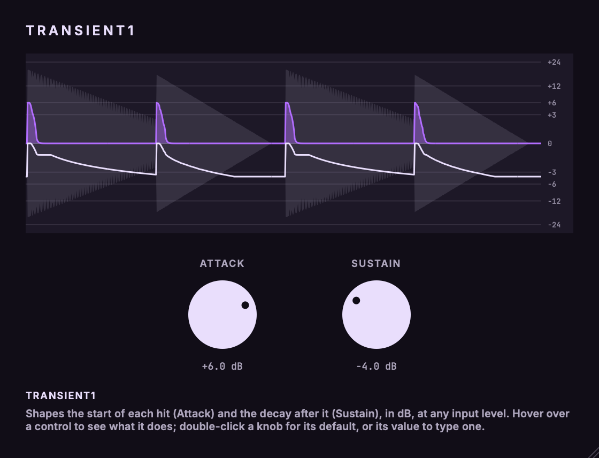

# Transient1

A two-knob transient shaper: Attack and Sustain, in dB.<br>
Part of the codycodie plug-in collection.

Transient1 raises or lowers the onset of each hit (Attack) and the decaying body that follows it
(Sustain). Each knob reads in dB and is the largest gain its section can apply; the applied gain
never goes beyond it. The result is the same at any input level above the noise floor, so you do
not set a threshold. Held, steady material gets a constant 12 % of the Sustain knob, which steps
aside while an onset is being detected. A 1 ms look-ahead, reported to the host, puts the gain in
place before the transient arrives. The output can exceed 0 dBFS: there is no limiter.
[docs/dsp.md](docs/dsp.md) has the algorithm, every constant with its provenance and the measurements.



**Editor.** A 560 x 428 window that scales from 0.75x to 2x (the scale is saved as `editorScale` in the plug-in state). The top
is a 2-second scrolling trace of the gain the engine actually applied, drawn from its telemetry (about 400 frames per second).
The vertical axis is dB with the same symmetric 0.5 skew as the knobs (grid at 0, +-3, +-6, +-12, +-24, so +-6 dB is half way out);
the violet filled line is the Attack section's gain, the pale line the Sustain section's, and the faint mirrored shape is the
input level (-60 to 0 dBFS, no axis of its own). With no audio running the trace is flat at 0. Below it are the Attack and Sustain
knobs (shift = fine, double-click a disc for 0 dB, double-click the value to type `-3`, `+6 dB` or `4.5`); the block at the bottom
left explains whatever is under the mouse. The palette "Ultraviolet" is a choice for this plug-in: background `110d17`, panel
`1d1827`, field `3a3149`, label `aea6bd`, pale `e9defc`, accent `b26dff`, text `ffffff` (contrast against the background: text 19.2,
label 8.2, pale 14.9, accent 6.0; accent on panel 5.4). Fonts: Inter SemiBold and JetBrains Mono Medium, bundled.

Transient1 is an independent product identity. Its bundle identifier is `com.c0dypeng.transient1`, its manufacturer code is
`Cdpg` and its plug-in code is `Trn1`. It builds as AU and VST3, mono-to-mono and stereo-to-stereo (stereo is linked: one detector
and one gain). This repository is licensed under GPL-3.0 (see [LICENSE](LICENSE)).

## Downloads

Get the latest packages from the [Transient1 releases page](https://github.com/chijenpeng/transient1/releases/latest). The macOS
release contains Universal AU and VST3 bundles for Apple Silicon and Intel; the bundles are ad-hoc signed and not notarized. The
Windows release contains a native x64 VST3, unsigned. Each ZIP includes `INSTALL.txt`, `THIRD_PARTY_NOTICES.md`, `LICENSE`, the
dependency licences and build provenance, with a `.sha256` companion file.

## Controls

| Control | Range | Default | What it does |
|---|---|---|---|
| Attack (`attack`) | -24..+24 dB, step 0.1 | 0 | The largest gain the Attack section applies to the onset of a hit. A steady wash and the low tail after a hit do not count as onsets. The boost fades over about 40 ms after each onset, so fast patterns (1/32 notes at 110 BPM) keep most of it. Positive makes hits snappier, negative softer. |
| Sustain (`sustain`) | -24..+24 dB, step 0.1 | 0 | The largest gain the Sustain section applies to the decay after a hit. Held, steady material gets a constant 0.12 of the knob (+-2.88 dB at +-24); that part steps aside while an onset is being detected, so hits on continuous material are cut less than the wash. |

Both are displayed as `+6.0 dB`. The knob law is a symmetric skew of 0.5 around 0 dB, so +-6 dB sits at half of each side's travel
(the stored value is always the dB). At 0 dB both sections do nothing and the output is the input delayed by the latency, bit for bit.
The state carries version 1.

## Limits

- There is no limiter. Boosts can take the output above 0 dBFS.
- Each section fades out to 0 dB between -84 and -72 dBFS of its own detector level, so noise and digital silence are never lifted.
  Very quiet tails are therefore level dependent by design; above that range the result does not depend on the input level.
- Latency is 1 ms (`round(0.001 x sample rate)` samples: 44 at 44.1 kHz, 48 at 48 kHz, 96 at 96 kHz, 192 at 192 kHz), constant for any
  knob value and reported to the host. Host bypass keeps the audio delayed.
- At sample rates above 96 kHz (176.4 and 192 kHz) the detector runs at half the rate, to avoid low-frequency ripple in the
  envelope; latency is unchanged.
- Attack fades out for onsets 30 to 36 dB below the track's own recent peak level (1 s memory, then a 6 dB/s fall), so a very soft
  hit right after a loud one is not shaped.
- The +-24 dB range and the 0.5 knob skew are choices for this plug-in, as are the detector times and depths listed in
  [docs/dsp.md](docs/dsp.md).

## Build

CMake 3.22 or later and a C++17 compiler. For AU and VST3 builds use macOS 11 or later; the Windows VST3 release uses native x64
MSVC from Visual Studio 2022. JUCE 8.0.9: a checkout or symlink at `third_party/JUCE` is used when present, otherwise CMake fetches
the tagged release.

```sh
cmake -S . -B build -G Ninja -DCMAKE_BUILD_TYPE=Release
cmake --build build -j4
ctest --test-dir build --output-on-failure
```

For a universal macOS build add `-DCMAKE_OSX_ARCHITECTURES="arm64;x86_64"`. Plug-in copying is disabled by default
(`-DCOPY_PLUGIN_AFTER_BUILD=ON` copies the AU and VST3 bundles into the user's Audio Plug-Ins folders). Build products are under
`build/Transient1_artefacts/Release`.

## Validation and snapshots

`transient1_test` (CTest `transient1_test`) prints PASS or FAIL per check and exits non-zero on any failure. It checks: bit-exact
neutral at 0 dB across channel counts, rates and block sizes; that each knob value is reached and never exceeded; level independence
(a recording scaled by +6 to -36 dB gets the same gain); steady and held material (constant body gain, no ripple, THD of held
low sines, including 176.4 and 192 kHz); fast repeats; onset detection (no Attack on a steady wash, one Attack peak per hit on a
kick with a body); the shape of the gain on a tone onset; reported latency against the measured
impulse delay at six sample rates; clicks after an Attack cut; the stereo link and mono; allocation-free processing; state round trip,
parameter mapping and old or garbage state; zipper-free knob sweeps; and a coarse CPU guard. Checks that need real recordings (drum mix, kick,
bass DI) run only when `TRANSIENT1_TEST_AUDIO` names a folder with `drums/drums.wav`, `drums/kick.wav` and `di/bass.wav`; otherwise
they are skipped with a message.

```sh
./build/transient1_test_artefacts/Release/transient1_test
cmake --build build --target transient1_snapshot
./build/transient1_snapshot_artefacts/Release/transient1_snapshot docs/editor.png --synthetic   # optional: editorScale pixelScale startSeconds
tools/package_macos.sh            # macOS package from a clean commit, after a build-release build
```

`docs/editor.png` is rendered with `--synthetic` (a synthetic kick and snare pattern, Attack +6 dB, Sustain -4 dB). The Windows
package is built and tested natively by the manual `windows-release.yml` workflow.
